# Intelligent Community Blogging and Content Discovery Platform

DBMS Experiential Learning, Level 3 mini-project, PES University. Two-member team.

A community blogging website. Users publish articles in communities, tag them, comment and reply, react, bookmark, and follow authors. Admins moderate content and manage communities and users.

Readers often struggle to find relevant posts, and keyword search misses articles that say the same thing in different words. So the platform offers two kinds of search:

- **Keyword search:** PostgreSQL full-text search (`tsvector`, GIN index, `ts_rank`).
- **Search by meaning:** text embeddings stored with `pgvector` and ranked by cosine distance.

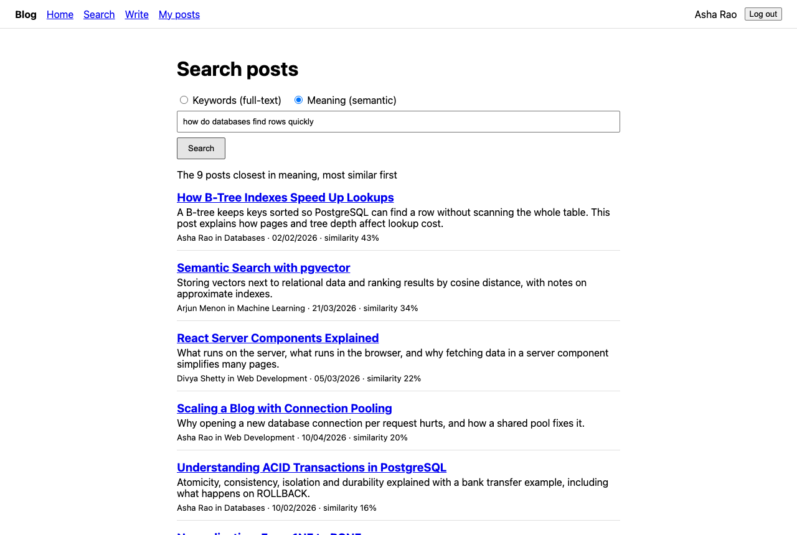

*"how do databases find rows quickly" finds the B-tree post first, although the two share no keywords.*

---

## Contents

1. [Why these databases](#why-these-databases)
2. [Tech stack and architecture](#tech-stack-and-architecture)
3. [Data model and integrity rules](#data-model-and-integrity-rules)
4. [Database features demonstrated](#database-features-demonstrated)
5. [Run it locally](#run-it-locally)
6. [Screenshots](#screenshots)
7. [API reference](#api-reference)
8. [Security](#security)
9. [Testing](#testing)
10. [Project layout](#project-layout)
11. [Limitations](#limitations)
12. [Team](#team)
13. [Documents](#documents)

---

## Why these databases

| Type of data | Stored in | Why it fits |
|---|---|---|
| Users, posts, communities, comments, follows and other linked records | PostgreSQL tables | Strongly relational: needs keys, joins, constraints and transactions |
| Meaning of each post | `vector(384)` column (`pgvector`) in the same PostgreSQL database | Comparing meaning needs vectors. Keeping them beside the posts means a similarity search can be filtered by post status with an ordinary join, and a post and its vector are saved in one transaction |

This is Option 2 (SQL + Vector Database) in §3 of the assignment, which lists PostgreSQL with pgvector as an accepted vector database.

## Tech stack and architecture

| Layer | Choice |
|---|---|
| Database | PostgreSQL 16 + `pgvector` 0.8, run in Docker (`pgvector/pgvector:pg16`) |
| Data access | Raw SQL with the `pg` library and parameterised queries (`$1, $2 …`). **No ORM**, so all SQL is visible |
| Web app and API | Next.js 16 (App Router); Route Handlers are the API layer |
| Passwords | bcrypt hashes (`bcryptjs`, cost 10) |
| Sessions | Signed JWT (`jose`, HS256) in an httpOnly, SameSite=Lax cookie, 8 hours |
| Embeddings | `all-MiniLM-L6-v2` via `@huggingface/transformers`; runs locally, free, no API key; 384 dimensions |

```text
Browser (React pages)
   │  fetch /api/...
   ▼
Next.js Route Handlers   ← validation, login and USER/ADMIN checks, error mapping
   │  parameterised SQL (pg Pool)
   ▼
PostgreSQL 16 + pgvector ← constraints, triggers, views, indexes, transactions
```

The browser never talks to the database directly. Every rule that can be enforced in the database is enforced there; the API checks the same rules again to give clear error messages.

## Data model and integrity rules

12 tables, built from 7 entities and 5 many-to-many relationships.

| Group | Tables |
|---|---|
| People and places | `users`, `communities`, `community_members` |
| Content | `posts`, `tags`, `post_tags`, `comments` |
| Interaction | `reactions`, `bookmarks`, `follows`, `reading_activity` |
| Search | `post_embeddings` (plus the generated column `posts.search_vector`) |

- [ER diagram (Chen notation)](docs/ER_diagram_final.png) and [logical model](docs/ER_logical_model.png)
- [ER explanation, relational mapping and viva questions](docs/ER_explanation_and_viva.md)
- [Relational schema](docs/relational_schema.md) and [data dictionary](docs/data_dictionary.md)
- [Vector data model and retrieval strategy](docs/vector_search.md)

| Rule | Meaning | Enforced by |
|---|---|---|
| C1 | Users cannot follow themselves | `CHECK (follower_id <> followee_id)` |
| C2 | A reply is on the same post as its parent | Composite foreign key `(parent_comment_id, post_id) → comments(comment_id, post_id)` |
| C3 | Valid role, statuses, reaction and activity types | `CHECK … IN (…)` |
| C4 | A published post has a `published_at` | `CHECK` |
| C5 | Only admins create communities | Trigger `communities_creator_must_be_admin` (needs another table, so a CHECK cannot do it) |
| C6 | Fixed vector size; one embedding per post and model | `vector(384)` and primary key `(post_id, model_name)` |
| C7 | Only published, non-removed posts appear in feeds, search and recommendations | View `published_posts` (`WITH CHECK OPTION`) used by every public query |
| C8 | Passwords stored only as hashes | bcrypt in the API; plain passwords are never stored or logged |
| C9 | `updated_at` is not before `created_at` | `CHECK` on `posts` and `comments` |

Delete rules are chosen per relationship: `CASCADE` for data that has no meaning without its parent (embeddings, tags of a post, memberships), `RESTRICT` where deleting would destroy other people's content (a community that still has posts, an author), and soft delete (`status = 'removed'`) for moderation, so reply threads stay intact. Counts such as likes and comments are always computed with queries, never stored.

## Database features demonstrated

Each file runs on its own in `psql` and prints what it shows.

| File | Shows |
|---|---|
| [db/schema.sql](db/schema.sql) | All 12 tables: PK, FK, UNIQUE, NOT NULL, CHECK, composite FK, generated `tsvector` column, `vector(384)` |
| [db/seed.sql](db/seed.sql) | Sample data, then deliberately invalid inserts that each constraint rejects |
| [db/queries.sql](db/queries.sql) | JOIN, GROUP BY, HAVING, ORDER BY, subqueries |
| [db/advanced/triggers.sql](db/advanced/triggers.sql) | C5 trigger and the automatic `updated_at` trigger, with tests |
| [db/advanced/views.sql](db/advanced/views.sql) | `published_posts` (updatable, `WITH CHECK OPTION`) and `popular_posts` (aggregates without join fan-out) |
| [db/advanced/transactions.sql](db/advanced/transactions.sql) | No transaction vs COMMIT vs ROLLBACK vs SAVEPOINT |
| [db/advanced/indexes.sql](db/advanced/indexes.sql) | `EXPLAIN ANALYZE` before and after indexing 100k rows, partial index, why the planner still picks a sequential scan on small tables |
| [db/advanced/fulltext.sql](db/advanced/fulltext.sql) | GIN index on `search_vector`, ranking, phrase and excluded words |
| [db/advanced/vector_search.sql](db/advanced/vector_search.sql) | Similar posts with `<=>`, HNSW index with `EXPLAIN`, the C7 filter |
| [db/alter_drop_demo.sql](db/alter_drop_demo.sql) | ALTER (add/rename/retype columns, constraints) and DROP, including a failing ALTER and a rolled-back DDL change |

In the application:

- **Transactions:** creating a post saves the post, its tags and its embedding in one transaction; editing locks the row with `SELECT … FOR UPDATE` to prevent lost updates; admin statistics run in one `REPEATABLE READ READ ONLY` transaction so every number comes from the same snapshot.
- **Upsert:** one reaction per user per post (`INSERT … ON CONFLICT DO UPDATE`).
- **Recursive query:** comment threads are built with `WITH RECURSIVE`.
- **Constraints as the source of truth:** the API does not check "does this already exist?" before inserting. It lets the UNIQUE, FK and CHECK constraints decide atomically and translates the error code (23505 → 409, 23503 → 400/404/409, 23514 → 400).

## Run it locally

You need [Docker Desktop](https://www.docker.com/products/docker-desktop/) and [Node.js](https://nodejs.org/) 20 or later. Run everything from the project folder.

**1. Install packages and create the settings file** (first time only)

```bash
npm install
cp .env.example .env.local
sed -i '' "s|replace-with-at-least-32-random-characters|$(openssl rand -base64 32)|" .env.local
```

On Linux, use `sed -i` without the `''`. `.env.local` is never committed.

**2. Start the database** (Docker Desktop must be running)

```bash
docker compose up -d
```

This starts the `blogdb_nextjs` container on port 5433.

**3. Create the tables and load the data** (first time, or to reset everything)

```bash
for f in db/schema.sql db/seed.sql db/advanced/triggers.sql db/advanced/views.sql \
         db/advanced/indexes.sql db/advanced/fulltext.sql db/seed_embeddings.sql \
         db/advanced/vector_search.sql; do
  echo "== $f"; docker exec -i blogdb_nextjs psql -U postgres -d blog < "$f" > /dev/null
done
```

`ERROR` lines from `seed.sql`, `triggers.sql` and `views.sql` are expected: they are the invalid statements that must be rejected. `schema.sql` drops and recreates every table, so this replaces all data.

**4. Start the website**

```bash
npm run dev
```

Open <http://localhost:3000>. The first "search by meaning" downloads the embedding model (about 90 MB, once).

**Seed accounts** (development password only):

| Email | Role | Password |
|---|---|---|
| `ravi@example.com` | ADMIN | `Passw0rd!` |
| `meena@example.com` | ADMIN | `Passw0rd!` |
| `asha@example.com` | USER | `Passw0rd!` |
| `karthik@example.com`, `divya@`, `arjun@`, `sneha@`, `rahul@` | USER | `Passw0rd!` |

To explore the data: `docker exec -it blogdb_nextjs psql -U postgres -d blog` (`\dt` lists tables, `\q` quits).

## Screenshots

Taken from the running app with the seed data, logged in as **asha** (USER) and **ravi** (ADMIN).

| | |
|---|---|
| **Home feed, logged out.** Only published posts (C7), with counts computed per request. 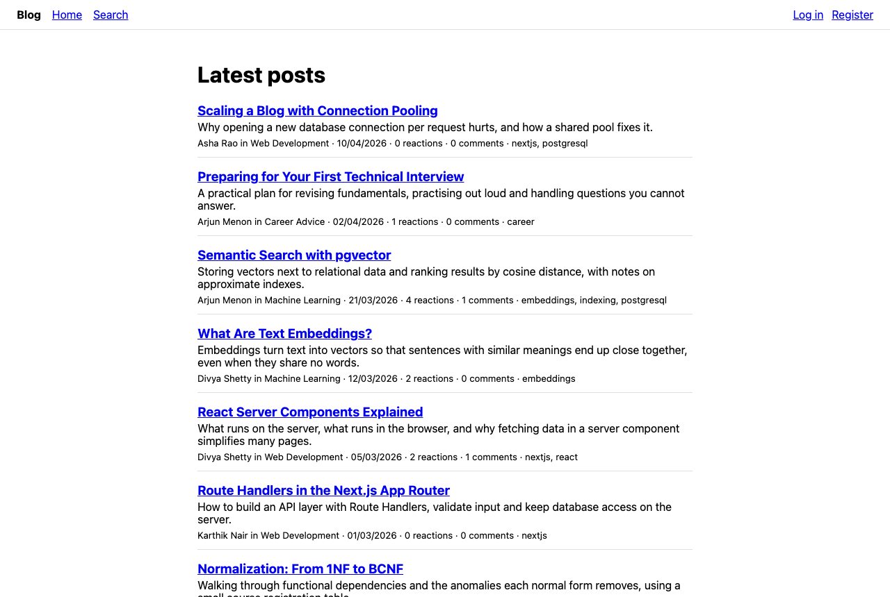 | **Register.** No role field: every new account is a USER. 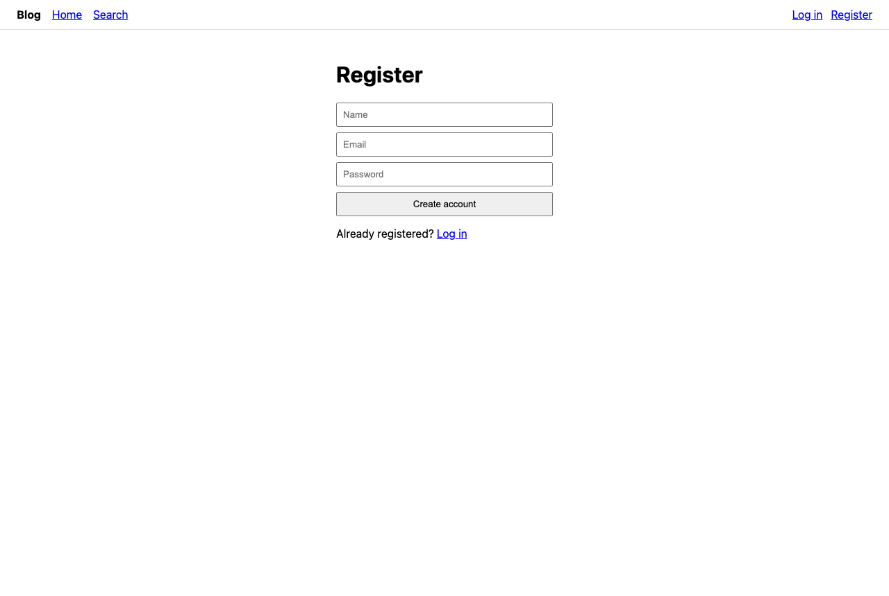 |
| **Log in** as asha. 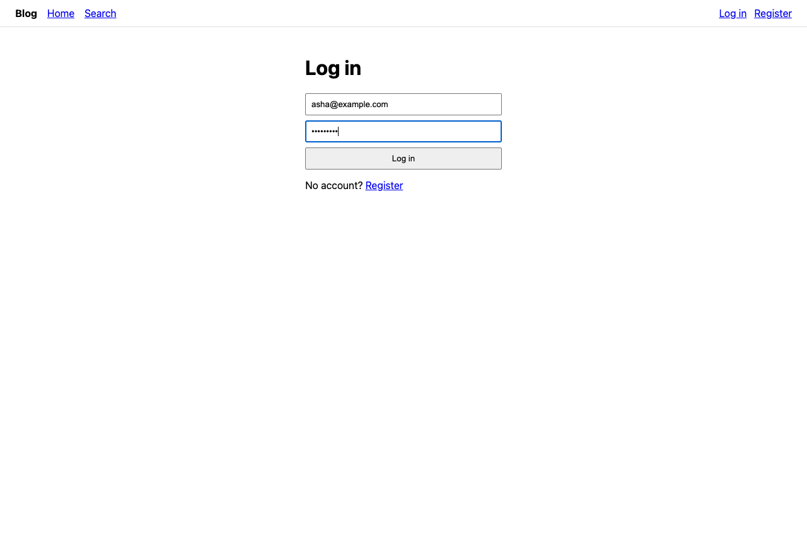 | **Home, logged in as asha.** 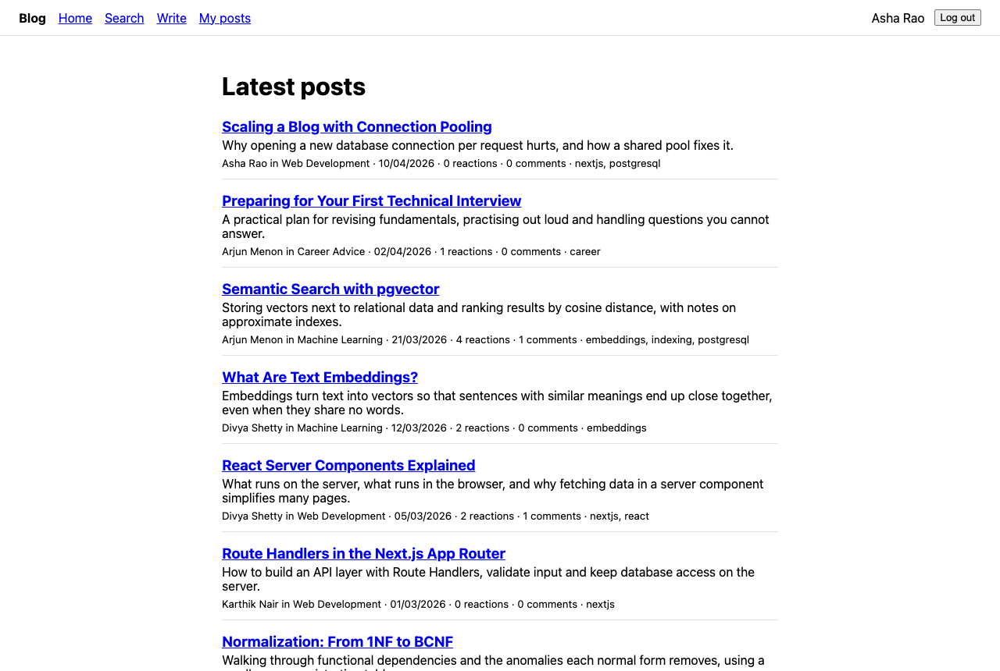 |
| **Keyword search** with highlighted matches, ranked by `ts_rank`, with community and tag filters. 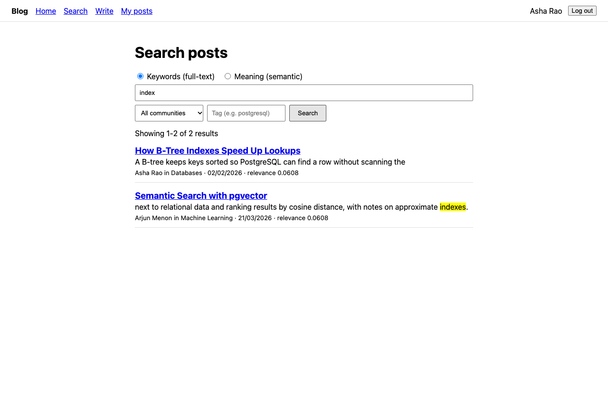 | **Search by meaning** (pgvector cosine similarity).  |
| **A draft, logged out:** "Post not found" (C7; the API does not reveal it exists). 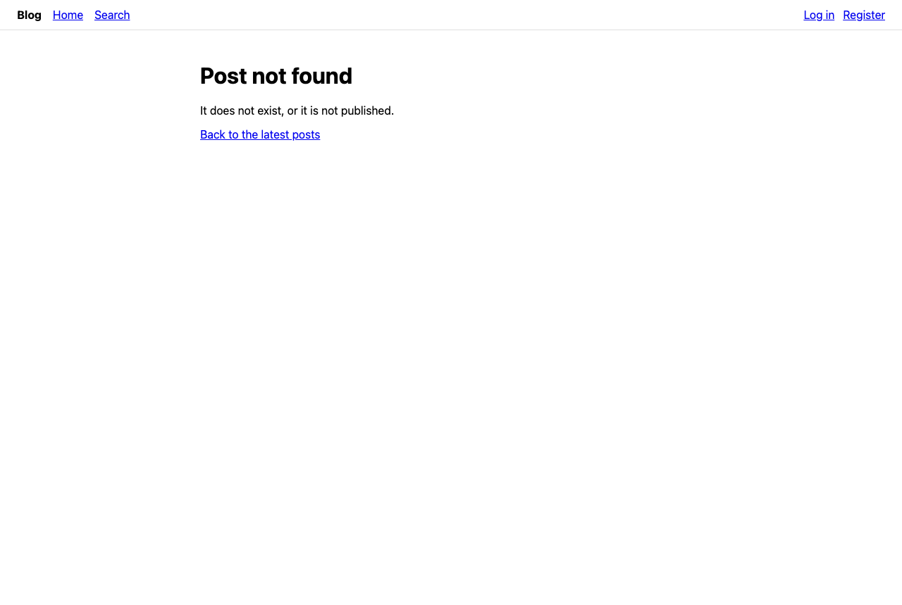 | **The same draft, as its author asha:** visible, with a warning. 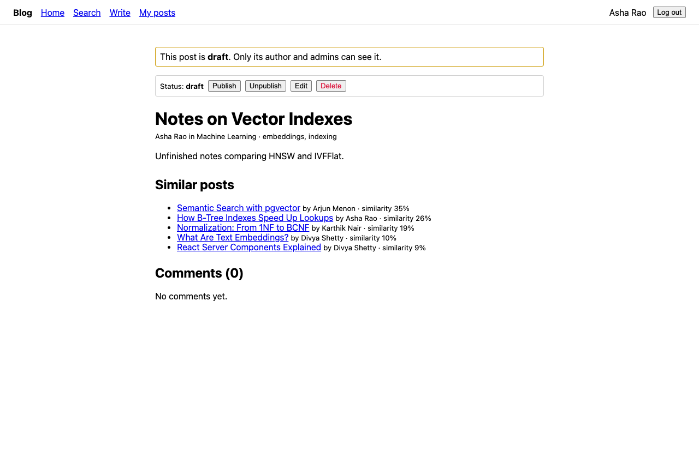 |
| **Admin (ravi) viewing a removed post.** Admins can see it; it never appears in listings.  | **Home as admin:** the nav bar shows "(admin)". 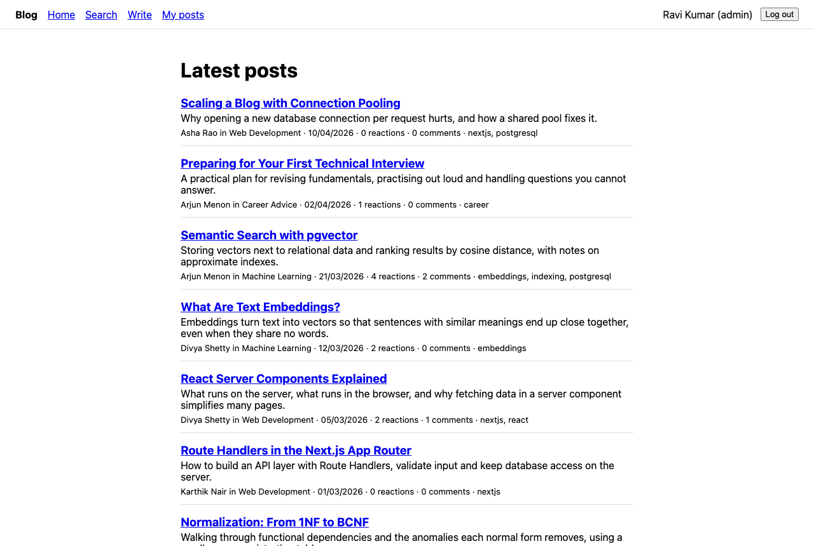 |
| **asha (USER) calling an admin API:** 403, checked in the API route. 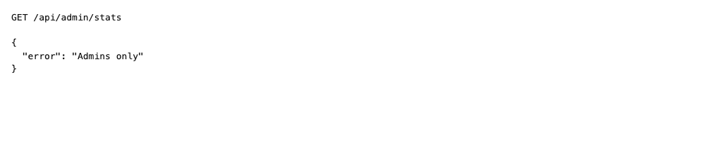 | **ravi (ADMIN) calling the same API:** statistics from GROUP BY, HAVING and NOT EXISTS queries in one REPEATABLE READ transaction. 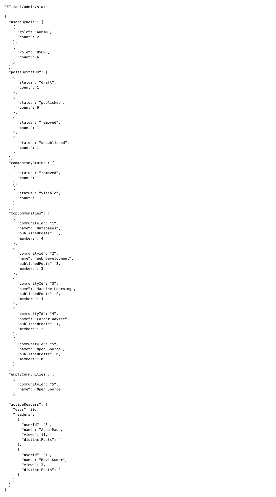 |

**Post page, as asha:** reactions (her own reaction in bold), bookmark, follow the author, similar posts from pgvector, and a comment thread where a moderator-removed comment shows as "[removed]" while its reply is kept (C2, soft delete).

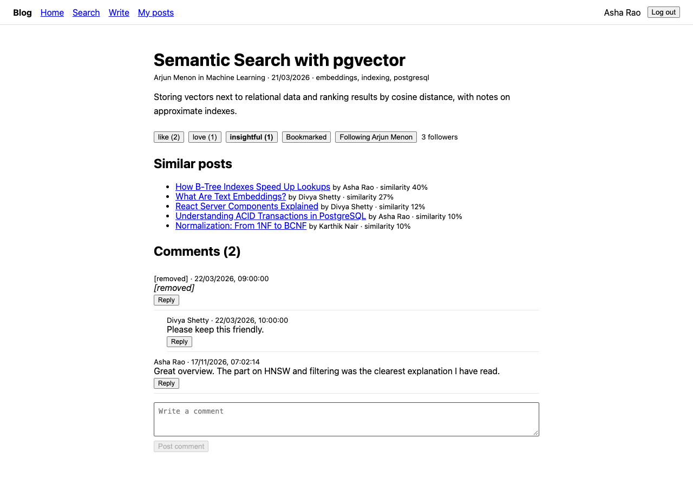

**Writing and managing posts**

| | |
|---|---|
| **Write a post:** save as a draft or publish. The post, its tags and its embedding are saved in one transaction. 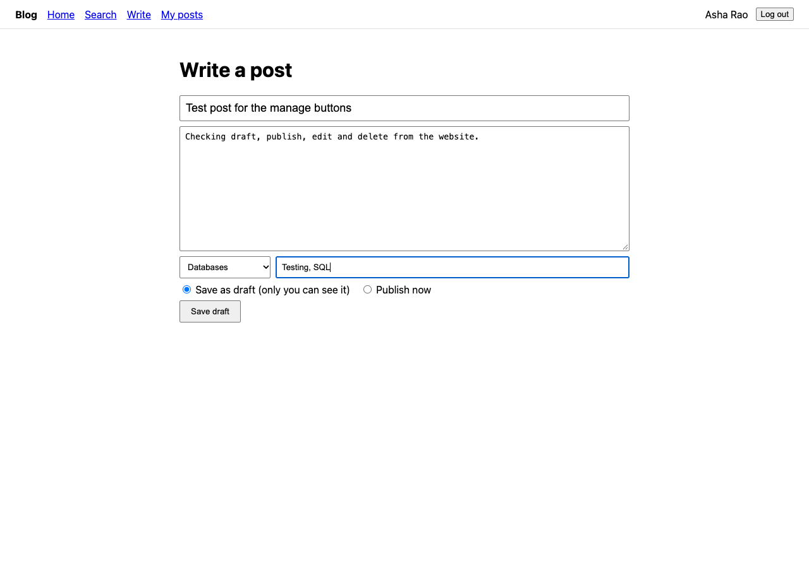 | **My posts:** the author's own posts in every status. The only list that shows drafts. 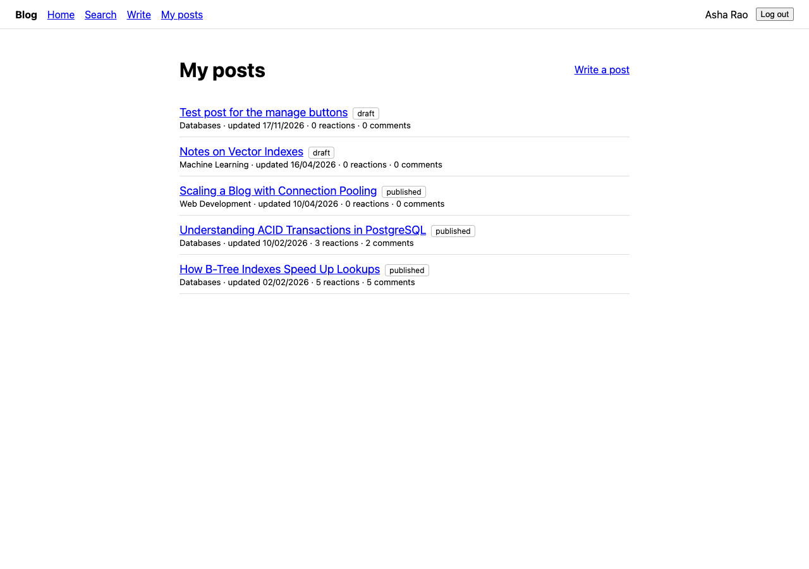 |
| **Author controls:** publish, unpublish, move to draft, edit (re-computes the embedding), delete (hard delete; `ON DELETE CASCADE` removes comments, reactions and the embedding). 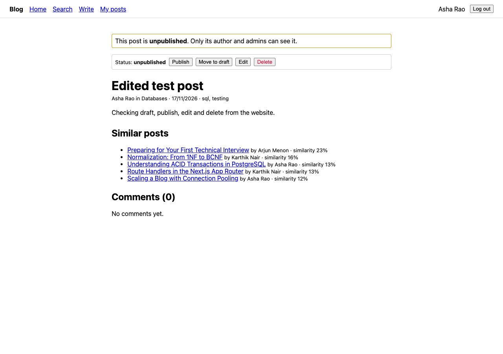 | **Admin controls:** remove (soft delete, `status = 'removed'`) and restore. The author can no longer edit a removed post. 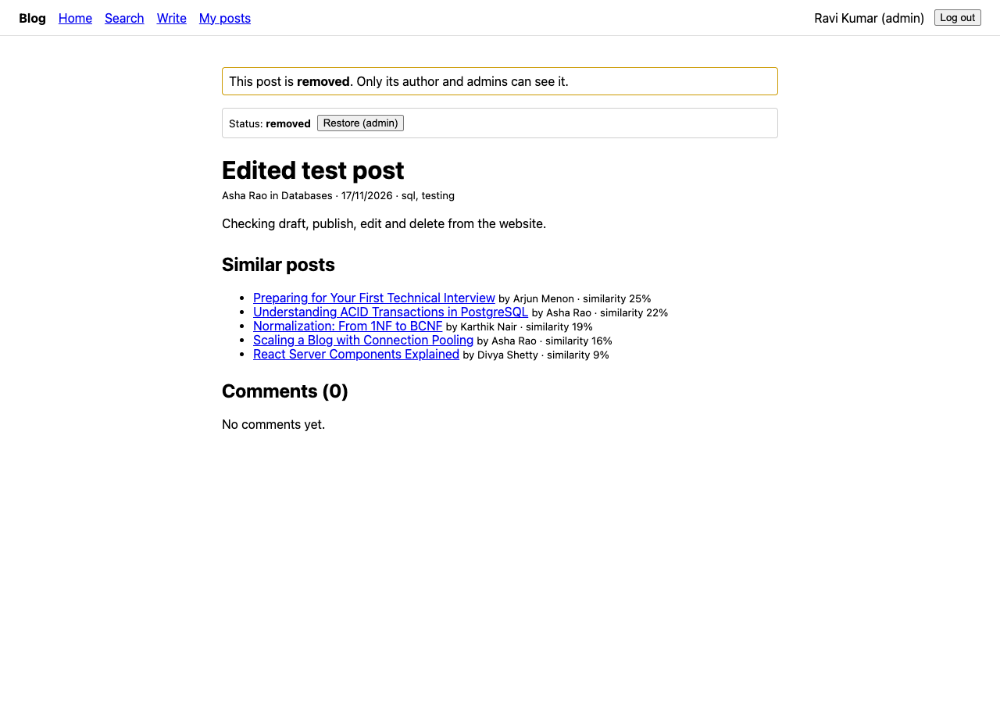 |

## API reference

All responses are JSON. 🔒 = login required, 👑 = admin only. Errors look like `{ "error": "message" }` and never contain SQL or stack traces.

| Method and path | What it does |
|---|---|
| `GET /api/health` | Database connection check |
| `POST /api/auth/register` | Create an account (always USER) and log in |
| `POST /api/auth/login`, `POST /api/auth/logout`, `GET /api/auth/me` | Session |
| `GET /api/posts?communityId=&authorId=&tag=&limit=&offset=` | Published posts, newest first; `?mine=true` 🔒 lists your own posts of any status |
| `POST /api/posts` 🔒 | Create a post with tags and embedding (one transaction) |
| `GET /api/posts/:id` | One post (drafts only for the author and admins) |
| `PATCH /api/posts/:id`, `DELETE /api/posts/:id` 🔒 | Edit or delete your own post |
| `GET /api/posts/:id/similar` | Most similar published posts (pgvector) |
| `GET /api/search?q=&community=&tag=&limit=&offset=` | Keyword search (full-text) |
| `GET /api/search/semantic?q=&limit=` | Search by meaning |
| `GET /api/communities`, `POST`/`DELETE /api/communities/:id/join` 🔒 | List, join and leave communities |
| `GET /api/tags?minPosts=` | Tags with published-post counts |
| `GET`/`POST /api/posts/:id/comments` | Threaded comments; add a comment or reply 🔒 |
| `PATCH`/`DELETE /api/comments/:id` 🔒 | Edit or delete your own comment |
| `GET`/`PUT`/`DELETE /api/posts/:id/reactions` | Reaction counts; react or change 🔒; remove 🔒 |
| `POST`/`DELETE /api/posts/:id/bookmark` 🔒, `GET /api/bookmarks` 🔒 | Bookmarks |
| `GET`/`POST`/`DELETE /api/users/:id/follow` | Follower counts; follow 🔒; unfollow 🔒 |
| `POST /api/posts/:id/activity` 🔒, `GET /api/activity` 🔒 | Record a view; your reading history |
| `PATCH /api/admin/posts/:id`, `PATCH /api/admin/comments/:id` 👑 | Remove or restore content (soft delete) |
| `POST /api/admin/communities`, `PATCH`/`DELETE /api/admin/communities/:id` 👑 | Manage communities |
| `GET /api/admin/users`, `PATCH /api/admin/users/:id` 👑 | List users, change a role (never your own) |
| `GET /api/admin/stats?days=` 👑 | Platform statistics |

## Security

- **SQL injection:** every query uses bound parameters; no SQL is built from strings.
- **Passwords:** bcrypt hashes only (8–72 bytes). Login takes the same time whether or not the email exists, so it does not reveal which accounts exist.
- **Sessions:** the cookie is httpOnly (JavaScript cannot read it), SameSite=Lax, and signed. It holds only the user id; the role is read from the database on every request, so a demotion applies immediately.
- **Authorisation** is enforced in each API route (401 not logged in, 403 not allowed), not only hidden in the UI. Users can never set their own role, author id or user id: these always come from the session.
- **Secrets** come from `.env.local` (never committed); `.env.example` holds placeholders.
- **XSS:** post and comment text is rendered as plain text, never as HTML.

## Testing

[docs/test_results.md](docs/test_results.md): **136 test cases, all passing.** Each one sends a real HTTP request to the running app, or an invalid SQL statement straight to PostgreSQL, and compares the result with the expected one. The tests cover:

- communities, tags, comments and moderation;
- reactions, bookmarks, follows and reading activity;
- full-text search;
- constraints C1, C2, C3, C4 and C7 and the composite primary keys, tested directly against the database.

The scripts are in [tests/](tests/) (PowerShell; see [tests/README.md](tests/README.md)).

## Project layout

```text
db/
  schema.sql, seed.sql, queries.sql      tables, sample data, demonstration queries
  seed_embeddings.sql                    384-d vectors for the seed posts
  alter_drop_demo.sql                    ALTER and DROP
  advanced/                              triggers, views, transactions, indexes, fulltext, vector_search
src/
  app/                                   pages: /, /login, /register, /search, /posts/[id], /write, /my-posts
  app/api/                               Route Handlers (the API)
  lib/                                   db pool, auth, sessions, passwords, transactions, embeddings, helpers
scripts/embed-seed/                      generates db/seed_embeddings.sql with the same model as the app
tests/                                   API and constraint test suite
docs/                                    assignment, ER diagrams and explanation, data dictionary,
                                         relational schema, vector search, test results, screenshots
docker-compose.yml                       PostgreSQL 16 + pgvector
```

## Limitations

- The website covers browsing, login, register, search (keywords and meaning), the post page with all reader interactions, writing posts, managing your own posts (status, edit, delete) and removing or restoring posts as an admin. Joining communities, the bookmarks and reading-history lists, comment moderation and user management are available through the API (see [API reference](#api-reference)) but have no pages yet.
- HNSW is approximate. With only 12 seed posts the planner prefers an exact scan; `db/advanced/vector_search.sql` shows the index being used on 10,000 vectors.
- Only posts are embedded, with one model. Long posts are cut at 512 tokens.
- The test scripts run on Windows PowerShell.

## Team

| Member | Area |
|---|---|
| Namitha R | Schema, seed data and queries; advanced database features (triggers, views, transactions, indexes); semantic search (SQL and app); authentication and roles; posts API; admin moderation; post page, write and my-posts pages |
| Ruchitha | Full-text search; Next.js skeleton; ALTER/DROP demo, data dictionary and relational schema; communities, tags and comments; reactions, bookmarks, follows and reading activity; search page and UI foundation; vector search documentation; test suite |

Both members share architecture, security, testing, documentation and the demo. Each feature was built on its own branch and reviewed by the other member through a pull request.

## Documents

- [Assignment requirements](docs/DBMS%20Level%203%20Project%20Requirements%20draft.pdf)
- [Feature specification (FR-01 to FR-14)](docs/intelligent_community_blogging_platform.md)
- [ER explanation and viva preparation](docs/ER_explanation_and_viva.md)
- [Relational schema](docs/relational_schema.md) · [Data dictionary](docs/data_dictionary.md) · [Vector search](docs/vector_search.md) · [Test results](docs/test_results.md)
