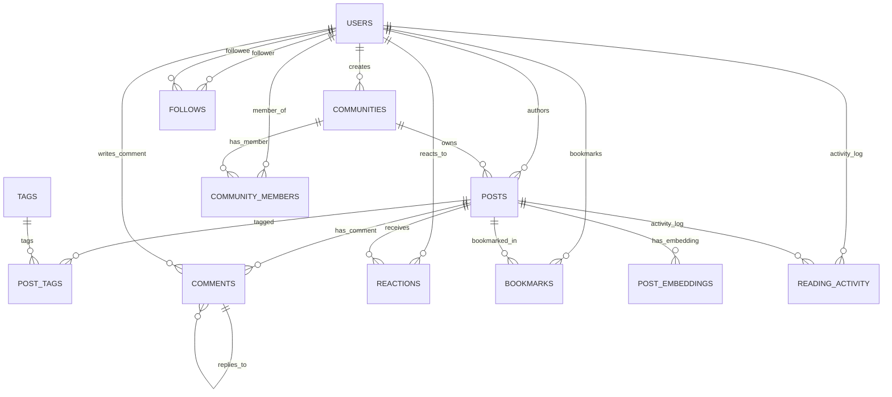

# Relational Schema Documentation

---

## Table definitions (standard notation)

Notation: **bold** = part of the primary key, _italic_ = foreign key (`-> table.column`).
A column can be both: in junction tables the composite primary key is made of foreign keys.

**bookmarks**(**_user_id_** -> users.user_id, **_post_id_** -> posts.post_id, bookmarked_at)  
**comments**(**comment_id**, _post_id_ -> posts.post_id, _author_id_ -> users.user_id, _(parent_comment_id, post_id)_ -> comments(comment_id, post_id), content, status, created_at, updated_at)  
**communities**(**community_id**, name, description, _created_by_ -> users.user_id, created_at)  
**community_members**(**_user_id_** -> users.user_id, **_community_id_** -> communities.community_id, joined_at)  
**follows**(**_follower_id_** -> users.user_id, **_followee_id_** -> users.user_id, followed_at)  
**post_embeddings**(**_post_id_** -> posts.post_id, **model_name**, embedding, created_at)  
**post_tags**(**_post_id_** -> posts.post_id, **_tag_id_** -> tags.tag_id)  
**posts**(**post_id**, _author_id_ -> users.user_id, _community_id_ -> communities.community_id, title, content, status, created_at, updated_at, published_at, search_vector)  
**reactions**(**_user_id_** -> users.user_id, **_post_id_** -> posts.post_id, reaction_type, reacted_at)  
**reading_activity**(**activity_id**, _user_id_ -> users.user_id, _post_id_ -> posts.post_id, activity_type, occurred_at)  
**tags**(**tag_id**, tag_name)  
**users**(**user_id**, name, email, password_hash, bio, role, created_at)

---

## Relationships table

| Entity A (PK) | Relationship | Entity B (FK) | Cardinality | Implemented by |
|---|---|---|---|---|
| `users` | creates | `communities.created_by` | 1 : N | FK `communities.created_by → users.user_id` |
| `users` | authors | `posts.author_id` | 1 : N | FK `posts.author_id → users.user_id` |
| `communities` | owns | `posts.community_id` | 1 : N | FK `posts.community_id → communities.community_id` |
| `posts` | tagged‑with | `post_tags` | 1 : N (via M:N) | Junction table `post_tags` |
| `tags` | tags‑post | `post_tags` | 1 : N (via M:N) | Junction table `post_tags` |
| `users` | member‑of | `community_members` | M : N | Junction table `community_members` |
| `communities` | has‑member | `community_members` | M : N | Junction table `community_members` |
| `posts` | has‑comment | `comments.post_id` | 1 : N | FK `comments.post_id → posts.post_id` |
| `users` | writes‑comment | `comments.author_id` | 1 : N | FK `comments.author_id → users.user_id` |
| `comments` | replies‑to | `comments.parent_comment_id` (self‑ref) | 1 : N (recursive) | Composite FK `(parent_comment_id, post_id) → comments(comment_id, post_id)` |
| `users` | reacts‑to | `reactions` | M : N (via PK) | PK `(user_id, post_id)` with FKs to both |
| `users` | bookmarks | `bookmarks` | M : N (via PK) | PK `(user_id, post_id)` with FKs to both |
| `users` | follows | `follows` (as follower) | M : N (self‑ref) | PK `(follower_id, followee_id)` with FKs to `users` |
| `users` | followed‑by | `follows` (as followee) | M : N (self‑ref) | Same as above |
| `posts` | has‑embedding | `post_embeddings` | 1 : N | FK `post_embeddings.post_id → posts.post_id` |
| `users` | activity‑log | `reading_activity.user_id` | 1 : N | FK `reading_activity.user_id → users.user_id` |
| `posts` | activity‑log | `reading_activity.post_id` | 1 : N | FK `reading_activity.post_id → posts.post_id` |

---

## ER‑to‑relational mapping notes
* **M:N relationships** (`posts↔tags`, `users↔communities`) are materialized as junction tables (`post_tags`, `community_members`) with composite primary keys.
* **Self‑referencing relationships** point back to the same table:
  * `follows` has two foreign keys (`follower_id`, `followee_id`), both to `users`.
  * `comments` has one composite foreign key `(parent_comment_id, post_id) → comments(comment_id, post_id)`, which also forces a reply onto the same post as its parent (C2).
* **Generated column** `posts.search_vector` is a stored `tsvector` derived from `title || ' ' || content`.
* **Vector column** `post_embeddings.embedding` is of type `vector(384)` (fixed dimension for the embedding model).
* **C9** (`updated_at >= created_at`) compares two columns of the same row, so it is a plain CHECK constraint (`posts_updated_after_created`, `comments_updated_after_created`), not a trigger.
* **Triggers** (in `db/advanced/triggers.sql`):
  * `communities_creator_must_be_admin` ensures only admin users can create a community (C5). A CHECK cannot do this because it needs to read another table (`users.role`).
  * `posts_set_updated_at` and `comments_set_updated_at` (function `set_updated_at()`) fill in `updated_at = now()` automatically on every UPDATE. This is a convenience; it does not enforce C9.

---

## Mermaid diagram (accurate to schema)
